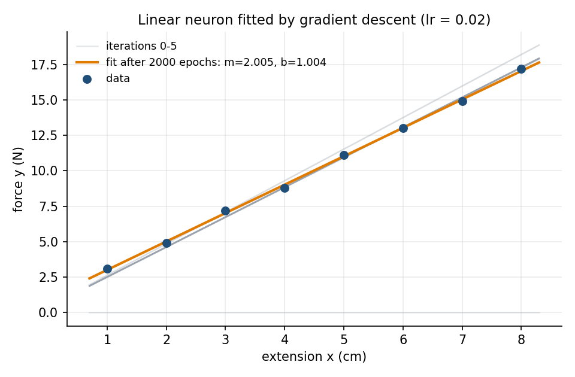
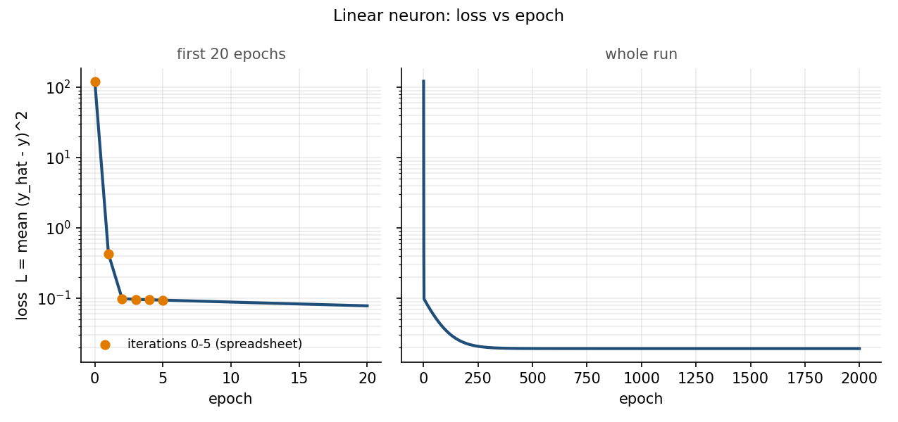
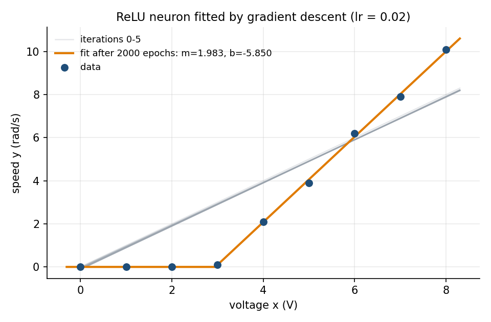
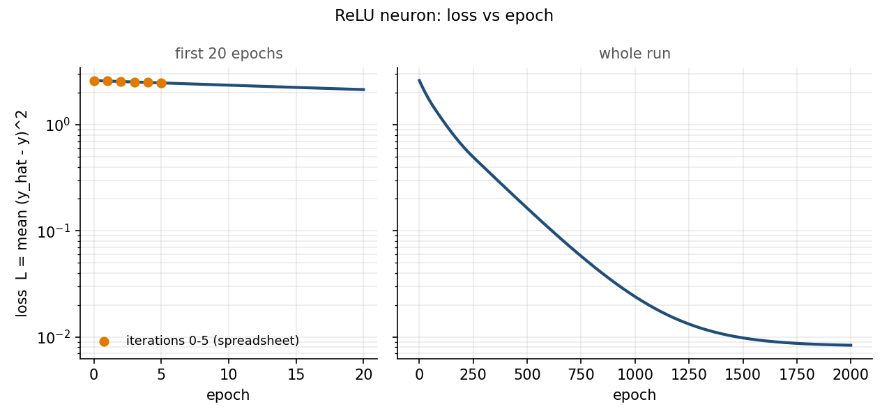

# Gradient descent for a single neuron (and a ReLU layer)

ME 193 homework. Three parts: the math, a spreadsheet that does five gradient-descent iterations on
$m$ and $b$ by hand, and Python that runs the same thing to convergence and plots the fit and the loss.

| File | What it is |
|---|---|
| `README.md` | this write-up (the math, results, how to run) |
| `gradient_descent_5_iterations.xlsx` | 5 iterations on $m, b$, every number a formula; sheet 1 linear neuron, sheet 2 ReLU neuron |
| `gd_neuron.py` | numpy-only gradient descent for both neurons, prints the first 5 iterations, saves the plots |
| `make_spreadsheet.py` | builds the workbook from the same data and starting values as `gd_neuron.py` |
| `figures/linear_fit.png`, `figures/linear_loss.png` | data + fit, loss vs epoch (linear neuron) |
| `figures/relu_fit.png`, `figures/relu_loss.png` | data + fit, loss vs epoch (ReLU neuron) |

## 1. The math

### 1.1 One neuron

A neuron with one input $x$, weight $m$ and bias $b$ computes a pre-activation and pushes it through an
activation function $\varphi$:

$$
z = m\,x + b, \qquad \hat{y} = \varphi(z).
$$

With $\varphi(z) = z$ it is a straight line $\hat y = mx + b$ (linear regression). With
$\varphi(z) = \mathrm{ReLU}(z) = \max(0, z)$ it is a hinge: zero until $z$ becomes positive, then a line.

### 1.2 Loss

For $N$ data points $(x_i, y_i)$ we measure how wrong the neuron is with the mean squared error

$$
L(m, b) = \frac{1}{N}\sum_{i=1}^{N}\left(\hat y_i - y_i\right)^2,
\qquad \hat y_i = \varphi(m x_i + b).
$$

$L$ is a bowl-shaped surface over the $(m, b)$ plane. Gradient descent walks downhill on it.

### 1.3 Gradient by the chain rule

Define the error $e_i = \hat y_i - y_i$. Three links in the chain:

$$
\frac{\partial L}{\partial \hat y_i} = \frac{2}{N}\,e_i, \qquad
\frac{\partial \hat y_i}{\partial z_i} = \varphi'(z_i), \qquad
\frac{\partial z_i}{\partial m} = x_i, \quad \frac{\partial z_i}{\partial b} = 1 .
$$

Multiplying them and summing over the data points:

$$
\frac{\partial L}{\partial m} = \frac{2}{N}\sum_{i=1}^{N} e_i\,\varphi'(z_i)\,x_i,
\qquad
\frac{\partial L}{\partial b} = \frac{2}{N}\sum_{i=1}^{N} e_i\,\varphi'(z_i).
$$

**Linear neuron.** $\varphi'(z) = 1$, so

$$
\frac{\partial L}{\partial m} = \frac{2}{N}\sum_i e_i\,x_i, \qquad
\frac{\partial L}{\partial b} = \frac{2}{N}\sum_i e_i .
$$

**ReLU neuron.** The derivative of $\max(0, z)$ is a gate:

$$
\varphi'(z) = g(z) =
\begin{cases} 1 & z > 0 \\ 0 & z \le 0 \end{cases}
\qquad\Longrightarrow\qquad
\frac{\partial L}{\partial m} = \frac{2}{N}\sum_i e_i\,g_i\,x_i, \quad
\frac{\partial L}{\partial b} = \frac{2}{N}\sum_i e_i\,g_i .
$$

Points sitting in the flat part of the ReLU ($z_i \le 0$) contribute nothing to the gradient, however
wrong they are. That is both the feature (the neuron ignores the dead band) and the danger: if every
$z_i \le 0$ the gradient is zero and the neuron is *dead*, so the starting $m, b$ must put at least some
points on the active side.

### 1.4 The update

With learning rate $\eta$, one iteration (one epoch, since we use all $N$ points) is

$$
m \leftarrow m - \eta\,\frac{\partial L}{\partial m}, \qquad
b \leftarrow b - \eta\,\frac{\partial L}{\partial b}.
$$

Repeat until $L$ stops decreasing.

### 1.5 How big can $\eta$ be?

For the linear neuron $L$ is exactly quadratic, with Hessian

$$
H = \frac{2}{N}\sum_i \begin{pmatrix} x_i^2 & x_i \\ x_i & 1 \end{pmatrix}
  = 2\begin{pmatrix} \overline{x^2} & \bar x \\ \bar x & 1 \end{pmatrix}.
$$

Gradient descent converges when $\eta < 2/\lambda_{\max}(H)$. For the spring data ($x = 1\ldots 8$:
$\overline{x^2} = 25.5$, $\bar x = 4.5$) $H = \begin{pmatrix} 51 & 9 \\ 9 & 2\end{pmatrix}$, with
eigenvalues $\lambda_{\max} \approx 52.6$ and $\lambda_{\min} \approx 0.40$. So $\eta$ must be below
about $0.038$; we use $\eta = 0.02$. The ratio $\lambda_{\max}/\lambda_{\min} \approx 130$ is why $m$
locks in within two iterations while $b$ creeps toward its answer over hundreds of epochs (see the
loss plot): the bowl is a long narrow valley along the $b$ direction.

### 1.6 Iteration 1 by hand (linear neuron, spring data)

Start at $m = 0, b = 0$, so $\hat y_i = 0$ and $e_i = -y_i$:

$$
\frac{\partial L}{\partial m} = \frac{2}{8}\sum_i (-y_i)\,x_i = \frac{2}{8}(-445.1) = -111.275, \qquad
\frac{\partial L}{\partial b} = \frac{2}{8}\sum_i (-y_i) = \frac{2}{8}(-80.2) = -20.05 .
$$

$$
m_1 = 0 - 0.02\,(-111.275) = 2.2255, \qquad b_1 = 0 - 0.02\,(-20.05) = 0.401 .
$$

$L$ drops from $121.62$ to $0.428$ in that one step. Iteration 1 in the spreadsheet shows the same numbers.

### 1.7 From one neuron to a ReLU layer

A hidden *layer* of $H$ ReLU neurons feeding one linear output neuron is

$$
z_j = w_j\,x + b_j, \qquad a_j = \mathrm{ReLU}(z_j), \qquad
\hat y = \sum_{j=1}^{H} v_j\,a_j + c .
$$

The same chain rule, now run backwards through two layers (this is backpropagation). With
$\delta_i = \frac{2}{N} e_i$ and gates $g_{ij} = [z_{ij} > 0]$:

$$
\frac{\partial L}{\partial v_j} = \sum_i \delta_i\,a_{ij}, \qquad
\frac{\partial L}{\partial c} = \sum_i \delta_i, \qquad
\frac{\partial L}{\partial w_j} = \sum_i \delta_i\,v_j\,g_{ij}\,x_i, \qquad
\frac{\partial L}{\partial b_j} = \sum_i \delta_i\,v_j\,g_{ij}.
$$

Each ReLU neuron contributes one hinge; the output sums $H$ hinges, which is a piecewise-linear curve
with up to $H$ kinks. That is how a stack of these fits curves that one line cannot. The single ReLU
neuron in part 2 is the $H = 1,\ v_1 = 1,\ c = 0$ case.

## 2. The spreadsheet

`gradient_descent_5_iterations.xlsx`, two sheets. Blue cells on yellow are inputs (data, $\eta$,
starting $m, b$); everything else is a formula, so change an input and all five iterations recompute.

Each iteration is one block of columns. The block reads $m, b$ from the block before it, then computes
per data point $\hat y_i$, $e_i = \hat y_i - y_i$ and $e_i x_i$ (plus $z_i$, the gate $g_i$ and
$e_i g_i$ on the ReLU sheet), and at the bottom $L$, $\partial L/\partial m$, $\partial L/\partial b$
and the new $m, b$. A summary table underneath lists $m, b, L$ for iterations 0 to 5.

| iteration | linear: $m$ | $b$ | $L$ | ReLU: $m$ | $b$ | $L$ |
|---|---|---|---|---|---|---|
| 0 | 0.0000 | 0.0000 | 121.6200 | 1.0000 | 0.0000 | 2.6100 |
| 1 | 2.2255 | 0.4010 | 0.4277 | 0.9889 | −0.0253 | 2.5774 |
| 2 | 2.1088 | 0.3854 | 0.0986 | 0.9919 | −0.0480 | 2.5514 |
| 3 | 2.1140 | 0.3914 | 0.0965 | 0.9958 | −0.0703 | 2.5258 |
| 4 | 2.1128 | 0.3962 | 0.0952 | 0.9997 | −0.0925 | 2.5005 |
| 5 | 2.1119 | 0.4011 | 0.0940 | 1.0037 | −0.1145 | 2.4756 |

The Python script prints the same table; the workbook was recalculated in Excel and the two agree to
every printed digit.

## 3. The Python

`gd_neuron.py` is numpy only: `forward`, `loss_and_grads` (the formulas of section 1.3) and `train`
(the update of section 1.4). It runs 2000 epochs at $\eta = 0.02$ for each neuron.

```bash
.venv/bin/python gd_neuron.py
```

(First time: `python3 -m venv .venv && .venv/bin/pip install numpy matplotlib openpyxl`.)

**Part 1, linear neuron, spring data** ($x$ = extension in cm, $y$ = force in N, about $2x + 1$ plus noise).
Gradient descent ends at $m = 2.0048$, $b = 1.0036$, $L = 0.0193$. The closed-form least-squares line
(`numpy.polyfit`) is $m = 2.0048$, $b = 1.0036$: identical, which is the check that the gradients are right.




**Part 2, ReLU neuron, motor data** ($x$ = voltage in V, $y$ = speed in rad/s). A real DC motor does not
move until the voltage beats friction, then speed grows linearly; the data is about
$\mathrm{ReLU}(2x - 6)$ plus noise. Starting from $m = 1, b = 0$ (so most points are on the active side and
the neuron is not dead) gradient descent ends at $m = 1.983$, $b = -5.850$, $L = 0.0084$. The fitted
dead band ends at $x = -b/m = 2.95$ V; the data's first non-zero speed is between 3 and 4 V.




## 4. What the plots say

- **Loss drops in two regimes.** The steep direction ($m$) is fixed in the first two or three epochs; the
  shallow direction ($b$) takes hundreds more. On the log axis the second regime is a straight line, the
  geometric decay you expect from a quadratic bowl with a small eigenvalue.
- **The grey lines in the fit plots are iterations 0 to 5**, the ones in the spreadsheet. For the linear
  neuron the slope is already right by iteration 2; the line then slides upward as $b$ catches up.
- **The ReLU neuron learns the dead band without being told where it is.** Points in the flat part only
  push on the fit when the hinge is wrongly placed over them (then $g_i = 1$ and they count); once the
  hinge moves past them they go silent. The ReLU loss curve has a long slow stretch while the kink walks
  from $x = 0$ out to $x \approx 3$ V.
- **Why $\eta = 0.02$:** section 1.5 bounds it at 0.038 for this data. At $\eta = 0.04$ the linear run
  diverges; at $\eta = 0.005$ it needs four times the epochs.
