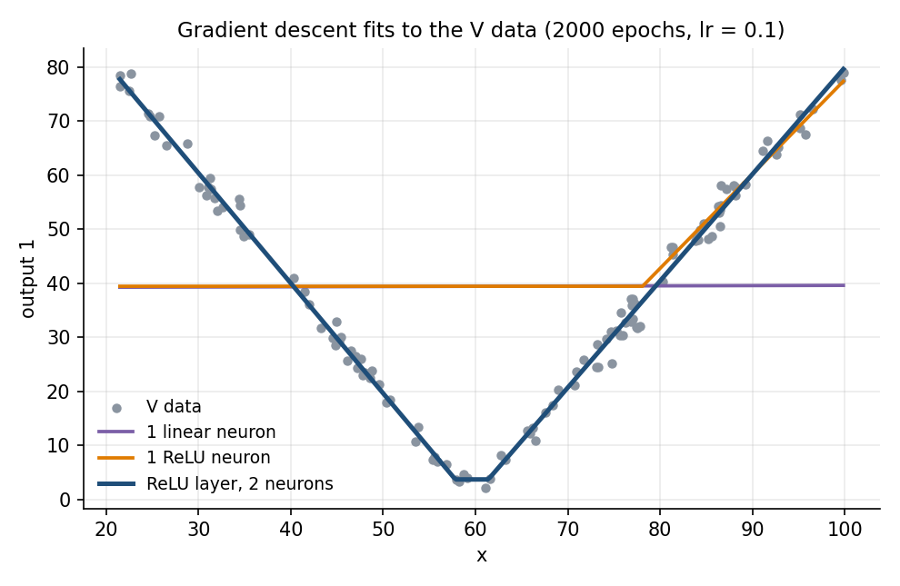
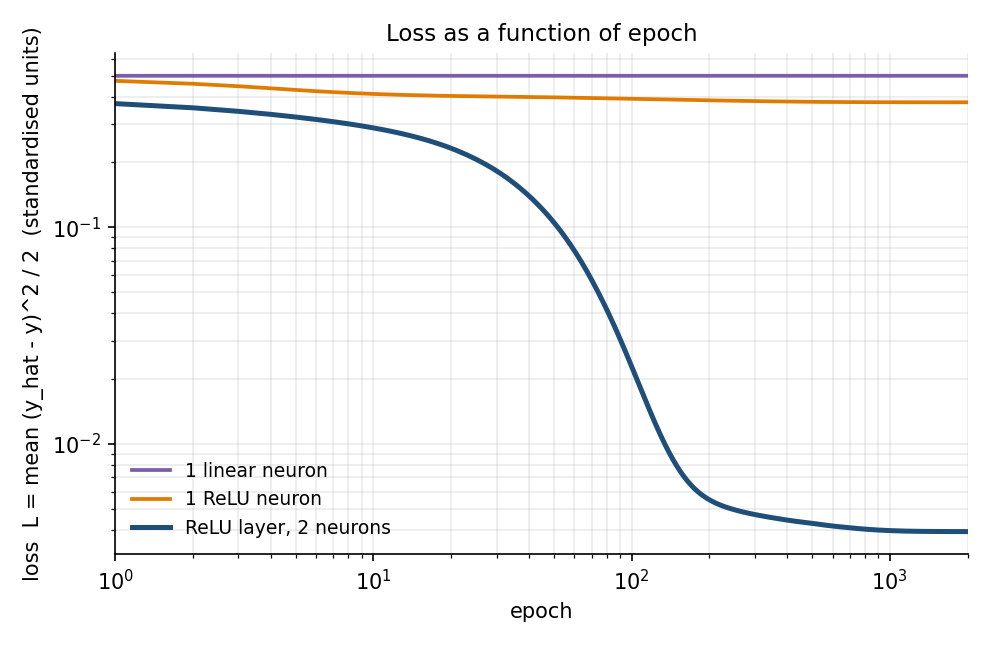

# Gradient descent for a single neuron and a ReLU layer

ME 193 homework, and the warm-up section of the Finger Lock midterm page.

| File | What it is |
|---|---|
| `README.md` | this write-up |
| `Book2.xlsx` | the class spreadsheet, finished: sheet `Gradient descent` has 5 iterations on m and b, all formulas |
| `gd_neuron.py` | numpy gradient descent on the V data (`data/annacode-v.tsv`), prints the spreadsheet check, saves the plots |
| `figures/v_fit.png`, `figures/v_loss.png` | data and fits, loss against epoch |

Run: `.venv/bin/python gd_neuron.py` (first time: `python3 -m venv .venv && .venv/bin/pip install numpy matplotlib`).

Before building the box I went back to what we started in class with Anna's code. Her data makes a V: the output falls as x goes up, hits zero near x = 60, then climbs again. The question is how a neuron finds its weights for a shape like that. I did it three ways: by hand, in Excel, and in Python.

### The math

One neuron takes an input $x$, multiplies it by a weight $m$, adds a bias $b$, and passes the result through an activation function $\varphi$:

$$z = m\,x + b, \qquad \hat y = \varphi(z)$$

To say how wrong it is over $N$ data points I use the mean squared error, with a half in front so the 2 cancels when I differentiate:

$$L(m, b) = \frac{1}{2N}\sum_{i=1}^{N}\left(\hat y_i - y_i\right)^2$$

Gradient descent needs the slope of $L$ with respect to each weight. With the error $e_i = \hat y_i - y_i$, the chain rule gives

$$\frac{\partial L}{\partial m} = \frac{1}{N}\sum_i e_i\,\varphi'(z_i)\,x_i, \qquad \frac{\partial L}{\partial b} = \frac{1}{N}\sum_i e_i\,\varphi'(z_i)$$

and every step moves the weights a little bit downhill, by the learning rate $\eta$:

$$m \leftarrow m - \eta\,\frac{\partial L}{\partial m}, \qquad b \leftarrow b - \eta\,\frac{\partial L}{\partial b}$$

For a plain linear neuron $\varphi(z) = z$, so $\varphi'(z) = 1$ and it drops out. For a ReLU neuron $\varphi(z) = \max(0, z)$, and its derivative is a switch:

$$\varphi'(z) = \begin{cases} 1 & z > 0 \\ 0 & z \le 0 \end{cases}$$

So a point only pushes on the weights when the neuron is switched on for that point. If the neuron is off for every point, nothing pushes at all and it is stuck, which is the dead ReLU problem.

One ReLU neuron is a single hinge, and a V needs two. A ReLU layer with two neurons feeding one output does it:

$$\hat y = v_1\,\mathrm{ReLU}(w_1 x + b_1) + v_2\,\mathrm{ReLU}(w_2 x + b_2) + c$$

The gradients come from the same chain rule, run backwards one layer at a time, which is all backpropagation is. With $a_j = \mathrm{ReLU}(z_j)$ and $g_j$ the on/off switch of neuron $j$:

$$\frac{\partial L}{\partial v_j} = \frac{1}{N}\sum_i e_i\,a_{ij}, \qquad \frac{\partial L}{\partial c} = \frac{1}{N}\sum_i e_i, \qquad \frac{\partial L}{\partial w_j} = \frac{1}{N}\sum_i e_i\,v_j\,g_{ij}\,x_i, \qquad \frac{\partial L}{\partial b_j} = \frac{1}{N}\sum_i e_i\,v_j\,g_{ij}$$

### Five iterations in Excel

This is the spreadsheet I started in class, finished. The data is the simple line from class, x = 1 to 5 and y = 2x, with learning rate 0.1 and both weights starting at 0. The sheet called Gradient descent has one block of columns per iteration. Each block works out the prediction, the error and error times x for every point, then the loss, the two gradients and the new m and b. The next block picks those up. Every number is a formula, so changing the learning rate or the starting guess reruns all five.

| iteration | m | b | loss |
|---|---|---|---|
| 0 | 0.0000 | 0.0000 | 22.0000 |
| 1 | 2.2000 | 0.6000 | 0.7600 |
| 2 | 1.8000 | 0.4800 | 0.0472 |
| 3 | 1.8760 | 0.4920 | 0.0226 |
| 4 | 1.8648 | 0.4800 | 0.0210 |
| 5 | 1.8695 | 0.4726 | 0.0203 |

The first step does most of the work. It overshoots m to 2.2, the second step pulls it back, and after that both creep toward the true answer of m = 2, b = 0. My Python prints the same numbers, which is how I checked the sheet.

### Python on the V data

`gd_neuron.py` is plain numpy, no PyTorch, so every gradient above is written out by hand. It trains three models on the 120 points of V data for 2000 epochs at a learning rate of 0.1.

```python
def neuron_step(x, y, m, b, lr, use_relu):
    z = m * x + b
    y_hat = relu(z) if use_relu else z
    e = y_hat - y                                   # error
    g = (z > 0).astype(float) if use_relu else 1.0  # 1 where the neuron is on
    loss = np.mean(e ** 2) / 2
    dm = np.mean(e * g * x)                         # dL/dm
    db = np.mean(e * g)                             # dL/db
    return m - lr * dm, b - lr * db, loss
```





| model | what it learns | error (RMSE, in output units) |
|---|---|---|
| one linear neuron | a flat line through the average | 21.0 |
| one ReLU neuron | the right arm only, flat everywhere else | 18.2 |
| ReLU layer, two neurons | the whole V | 1.9 |

A straight line has nothing to grab onto in a V, so the best it can do is sit at the average and its loss never moves. One ReLU neuron bends once, so it follows one arm and gives up on the other. Two ReLU neurons facing opposite ways put a hinge on each side of the bottom, at x = 57.8 and x = 61.4, and what is left over is about the size of the scatter in the data. That is the whole idea the finger counter is built on. It just has a million weights instead of seven.
